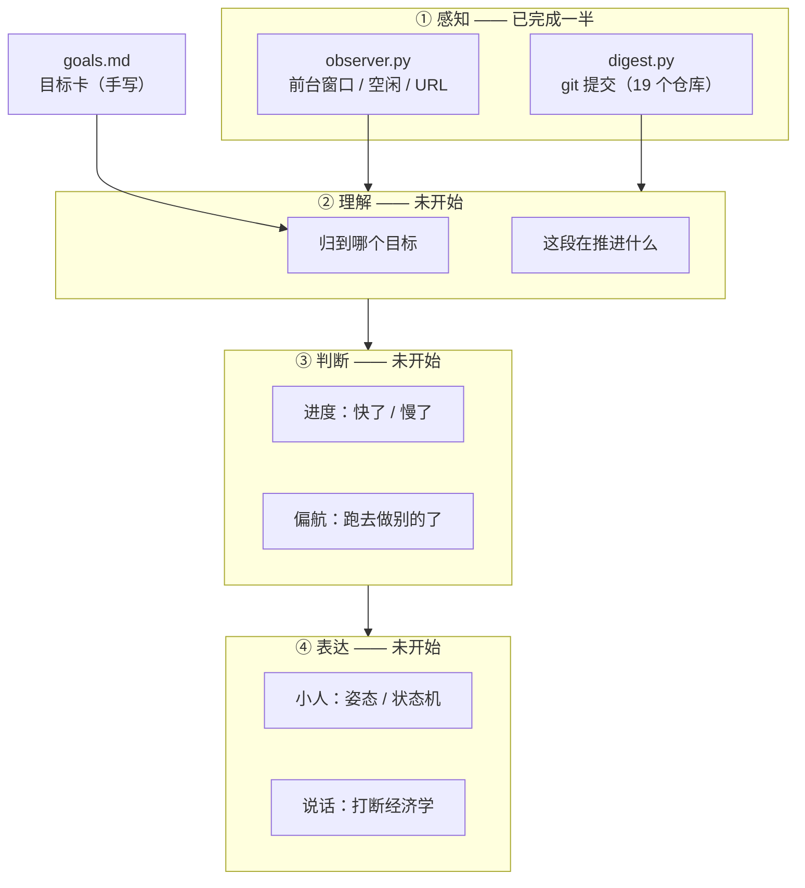

# 实现现状与取舍

> 这份文档回答四个问题：**现在已经做了什么、每个脚本能干什么、为什么这么做、以及这些东西怎么接到那个"小人"上。**
>
> 写给三个月后的自己看，所以只记录会忘的东西：判断、原因、踩过的坑。不讲怎么装 Python。

---

## 一、一句话现状

设计稿（`docs/design.md`）里画了四层：**感知 → 理解 → 判断 → 表达**。

现在做完的是**第一层的一半**，而且只覆盖了两个数据源里的一个半。

已经能每天自动产出东西，但**还没有"助手"**——没有小人、没有目标对齐、没有"什么时候该说话"的判断。这三件事一行代码都没写。

这个顺序不是意外，是有意为之，理由见第四节第 1 条。

---

## 二、有什么

| 文件 | 作用 | 状态 | 外部依赖 |
|---|---|---|---|
| `scripts/digest.py` | 每日提交总览：扫所有 git 仓库，汇总当天提交 | **主力，可用** | 无（仅 git） |
| `scripts/observer.py` | 桌面活动采集：前台窗口、空闲、浏览器 URL | 可用，需常驻 | 无（标准库 ctypes） |
| `scripts/report.py` | 把一天的原始片段整理成结构 + 分析提示词 | 可用 | observer 的数据库 |
| `scripts/daily_report.py` | 面向交付的工作日志（写进固定仓库） | 可用 | 无 |
| `scripts/goals.md` | 目标卡（手写，还没被任何代码读取） | 样例 | — |
| `examples/` | 真实跑出来的总结样例 | — | — |

全部**零第三方依赖**，只用 Python 标准库。这是一条硬约定，理由见第四节第 7 条。

---

## 三、每个脚本在做什么

### `observer.py` — 桌面活动采集

- 每 3 秒采样一次前台窗口：进程名、窗口标题、是否空闲
- 通过 Win32 API（`ctypes`）直接取，不装 `pywin32` / `psutil`
- 连续同窗口合并成"片段"，超过阈值自动切分，落 SQLite（`data/activity.db`，单文件）
- 浏览器 URL 走 Chrome/Edge 的 CDP `9222` 端口，没开就自动跳过
- 暂停机制：在 `data/` 下放一个 `PAUSE` 空文件即停

**为什么是 3 秒**：够细，一天切出来的片段数量在可读区间（几十到一百多段）；再密就是噪音，再疏就分不清"在两个文件之间来回跳"和"一直在写一个文件"。

**为什么用 ctypes 而不是装库**：这台机器上没有 `psutil`，而为了取一个窗口标题去引入依赖、处理版本冲突，不划算。代价是 Windows-only——自用够，将来跨平台要换实现。

### `digest.py` — 每日提交总览

这是目前最完整、最常跑的东西。

- 扫 `D:\yzj`（深扫 4 层）+ 编辑器最近打开的项目（浅扫 1 层）
- 每个仓库一次 `git log --all --numstat`，把提交元数据和文件变更量一起拿回来
- 按**作者日期**分天，按提交 sha 去重
- 产出一份五段式文档：今天做了什么 / 概览 / 分项目 / 全天节奏 / 统计

**它回答的不是"工作日志"，是"今天总共干了什么"**——包含那些不为了交付、只是想试试的提交。所以它不套工作日志的模板，不写进那个固定仓库（除非你配）。

### `report.py` — 当日结构与提示词

把 `activity.db` 里一天的片段整理成可读结构（每个应用多久、切了多少次、哪些标题反复出现），并生成一段给模型的分析提示词。

它不直接生成日报——因为这一层只该负责"把事实摆清楚"，由谁来说、怎么说，是下一层的事。

### `daily_report.py` — 面向交付的工作日志

周日到周四晚上跑，生成固定格式的日志，写进 `labbol工作日志` 仓库并提交。有 `lite`（零模型）和 `full`（调模型补"需求详情"）两档。

保留它是因为它有独立受众——那份日志是给别人看的，和"我今天干了啥"不是一回事。

---

## 四、七条决策，和为什么

### ① 先做采集，不先做小人

小人的每一个状态都要被数据驱动：歪头是因为"这段你回来三次了"，伸懒腰是因为"连续 90 分钟了"。没有数据，做出来就是一只会点头的玩具——而且会很快被关掉，因为它说不出任何你不知道的事。

采集是第一层，后面三层全部依赖它。所以哪怕它最不性感，也得先有。

### ② 只读 git 也算够用，因为 git 不会过期

"统计我在做什么"有两条路：读屏幕（实时、丰富、但要一直跑），读提交（稀疏、但**一个字都不会记错**）。

诱人的是前者，但前者的数据活不过一周——你今天半夜关了电脑，明天再想"上周三下午我在干啥"，窗口标题早就没了。

git 的好处是：你今天半夜关掉电脑，明年再来看，数据还在，而且能补。这也是为什么 `digest.py` 能一口气补齐过去 31 天，而 `observer.py` 一分钟都补不了。

**取舍很清楚：先要一份不会骗人但偏薄的记录，再考虑加厚的部分。**

### ③ 批处理，不做实时流

实时处理看起来很酷：边工作边分析、立刻反应。但它会带来三样东西：常驻内存、模型调用成本、一个复杂度陡增的状态机。

而"我今天干了啥"这个问题，晚上问一次就够。

所以现在是：`observer` 只管落库（永不分析），分析全部发生在读取时。这样采集器可以极简、极稳，挂了也不丢历史。

### ④ 不用 `git log --since/--until`

它们过滤的是 **committer date**，不是 author date。

一旦你 rebase 过，那天的提交 committer date 就变成合并日，整天的提交会凭空消失。

实测：`2026-07-07` 有 8 个提交，用日期过滤只捞到 2 个。

现在的做法：一次把区间内的 log 全读进内存，再按 `%aI`（作者时间）筛。`--since` 只用来做下界剪枝——它做的这个用途是安全的（committer date 永远 ≥ author date）。

### ⑤ 按提交 sha 去重

这台机器上有两份 `product-yun-knowledge-view`（`-v3` 那份），`remote` 完全是同一个。

不去重的话，同一天的 3 个提交会被算成 6 个，改动量直接翻倍。`2026-10-23` 实测：**15 条 → 去重后 12 条**。

sha 全局唯一，按它去重最可靠。文件数同理，但要按 `(仓库, 路径)` 去重——不同仓库里的 `src/index.ts` 是两个文件，按路径去重会把 578 算成 400 多。

### ⑥ 不写评价

不写"显著提升了效率"、"成功解决了难题"，不给效率分，不算专注时长。

原因不是谦虚，是**可信度**。脚本一旦开始替你下结论，这份总结就不能拿来做决定——你没法判断哪句是事实、哪句是它编的。而一个偶尔编一句话的助手，你会连带不信它说的所有真话。

它只陈述：几个仓库、几次提交、什么时候、改了哪些文件。

### ⑦ 零第三方依赖

只用标准库。理由：这些东西要跑五年。依赖会过时、会冲突、会让你某天打开一个旧项目时先花半小时修环境。

自用工具最怕的不是功能不够，是**某天它跑不起来了，于是你就再也不跑了**。

---

## 五、踩过的坑

| 坑 | 现象 | 原因 | 修法 |
|---|---|---|---|
| 日期过滤漏数据 | 07-07 明明 8 个提交，只捞到 2 个 | `--since` 按 committer date 过滤，rebase 后日期被改写 | 一次读入 + 按 `%aI` 内存筛 |
| 提交被算两遍 | 15 条变成 12 条（去重后） | 同一 remote 的本地多份 clone | 按 sha 全局去重 |
| 文件数虚高 | 578 文件里一堆重复 | 不同仓库的同名路径被当成同一个 | 按 `(仓库, 路径)` 去重 |
| 产出量失真 | 某天 `-101549` 行 | 删掉整个内置前端，属于迁移不是产出 | 单次 >5000 行单独标注 |
| 补多天超时 | 5 天就跑到超时 | 每天重扫一遍所有仓库 | 一次扫描 + 按天索引复用 |
| 中文被切坏 | `（P2 等 5 条` | 按字符数硬截断 | 优先断在标点处 |
| 自动找仓库失败 | 捞到 `.code-workspace` 文件路径 | 读了 `storage.json` 而非状态库 | 改读 `state.vscdb` 的 `recentlyOpenedPathsList` |
| 被 squash 的提交补不回 | 某天日志偏薄 | 对象还在库里，但不在任何 ref 上，`--all` 找不到 | **无法修复**，接受这个损失 |

最后一条是硬限制，写在这里是为了将来不要浪费时间再试一次。

---

## 六、从脚本到助手：怎么接

### 先看现在的位置

四层里，第 1 层做了一半（有 git 和窗口，缺 URL 之外的页面内容理解），第 2、3、4 层是零。

### 一个必须说清的事：这些脚本不是助手的功能，是助手的记忆

这是最容易搞混的地方。

`digest.py` 生成的那份总结，**不是给人看的日报，是助手理解"你这个人怎么工作"的原始素材**。

判断"进度快了还是慢了"，需要一个基线：你通常一周在某个项目上提交几次、你写完一个功能到提交之间的间隔是多久、你哪些天会完全不动代码。

这个基线**只能靠时间积累**，没有任何捷径。所以现在每天跑一份，本质上是在**攒数据**，而不是在交付功能。

换句话说：**这三个月跑出来的东西，价值不在那几份 Markdown，价值在那份已经被结构化的历史。**

### 三个要补的缺口

**缺口一：时间尺度不对（T+1 → T+0）**

现在所有产出都是"回顾"——晚上跑，看昨天/今天。助手需要的是"当下"——现在这一刻在干什么，已经连续多久了。

接法：把 `scan_repos` 从"按天汇总"改成"增量事件流"。现在的架构支持这件事：`observer` 已经是增量落库，把 git 也变成"每 5 分钟取一次新的提交"就行。

**缺口二：没有语义（提交 → 目标）**

现在知道"你在 `labbol_agent` 提交了 9 次"，不知道"这 9 次是在推进你的哪个目标"。

接法：`goals.md` 现在已经写好了格式（目标、期限、关键结果），但它是个死文件，没有任何代码读它。下一步是给它加解析，然后做一次**匹配**：把当天的提交/片段，归到 `goals.md` 里的某一条上。

这里有个关键判断：**匹配不上就归"未归类"，绝不硬猜。** 猜错一次然后去提醒用户，造成的信任损失十次做对都补不回来。

**缺口三：没有决策（数据 → 该不该说话）**

这是整个产品最值钱、也最难的一层，设计稿第 3 节写了"三道闸门"：值不值得说、此刻合不合适、说了有没有用。

它需要的输入恰好是前两层：有事件流知道"现在在干什么"，有目标对齐知道"偏了没有"。

### 最小闭环：如果只做一件事，做什么

**让 `digest` 的采集层每小时跑一次，结果写进一个 `state.json`；小人的五个状态直接读这个文件。**

不做目标对齐、不做打断判断、不做对话。就是一个小人，它的姿态反映"过去一小时你在几个仓库动过、动了多少次"。

理由：这是**唯一能在一个周末做完、并且能立刻看出"它是不是真的让你觉得有人陪着"**的一步。如果这一步没有感觉，后面所有东西都不用做了。

### 现有的解耦设计，是为此准备的

设计稿里定过一条：**主程序和用 `state.json` 解耦**，主程序只写 `{state, reason, since}`，小人每 500ms 轮询。

好处是：小人可以随时重做、换皮、关掉，主程序完全不受影响。也可以先做一个丑的假小人（一个色块），验证数据流通了再美化。

---

## 七、下一步的优先级

1. **让 `digest` 连续跑 30 天，不做任何新功能。**
   验收标准：你自己会不会主动打开它。不会，就别往下做——后面三周只是在放大一个你自己都不用的东西。

2. **加目标对齐**（`goals.md` 解析 + 匹配 + 低置信度降级）。
   这是从"记录"变成"助手"的真正分界点。没有它，再多的采集也只是个更详细的日记。

3. **做小人**（五个状态、`state.json` 驱动）。
   先做丑的，验证数据流，再谈好看。

4. **最后才做"什么时候说话"**。
   这一步放进去了，产品就开始有性格了，也最容易翻车。

顺序不能反。**先验证"你会不会看"，再验证"它该不该说"。**
